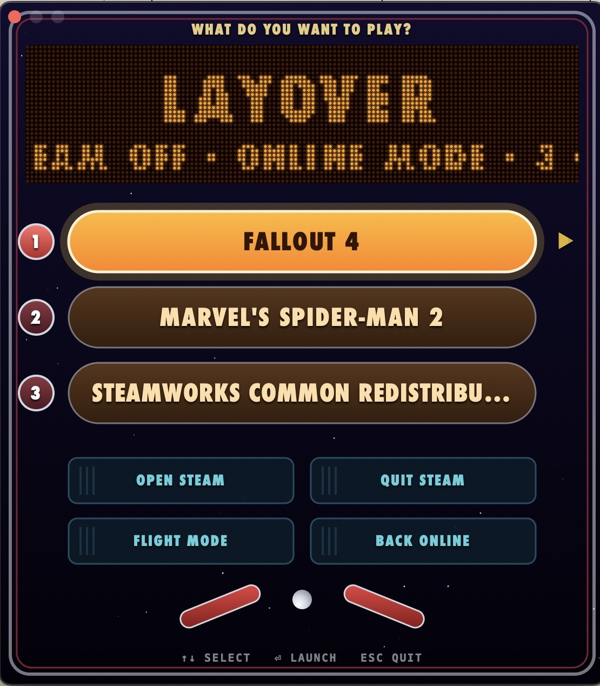

Layover is a homemade launcher that runs the windows version of Steam on my MacBook Pro.  It was made using Claude code and is fine tuned to play Spiderman 2.  

I'm not much of a gamer but I have a few long flights coming up and wanted to be able to funk around with some video games while journeying so I put Claude to the test to see if it could come up with a solution and it did a very good job.

I don't understand too much of what is going on underneath (whatever) but here is the essential gist of what I have working for me now
What it does

- One command sets it up. It downloads a Wine engine, the graphics translators and the Windows Steam client, about 440 MB, and installs them in roughly two minutes. It needs no admin password, and everything lives in one folder. Delete that folder and it's gone.
- It picks the graphics translator for each game. DirectX 11 games go through DXMT and DirectX 12 games go through Apple's D3DMetal. It reads each game's executable to decide.
- It's set up for flights. A pre-flight checklist checks the saved login, which games are ready, the controller, battery and disk space, then switches Steam to offline mode.
- Settings can differ per game. Frame-rate cap, Retina resolution, MetalFX upscaling and the renderer can each be set for one game. For example, Fallout 4 renders at a quarter of the pixels and Apple's MetalFX scales it up to fill the screen.
- It has a real Mac app. Layover.app is a native menu that looks like a pinball backglass, with a dot-matrix display, lit game inserts and rollover buttons. You never need the Terminal after setup.

It was heating my computer up substantially but after a few more prompts to Claude, the games run much more efficiently.  

