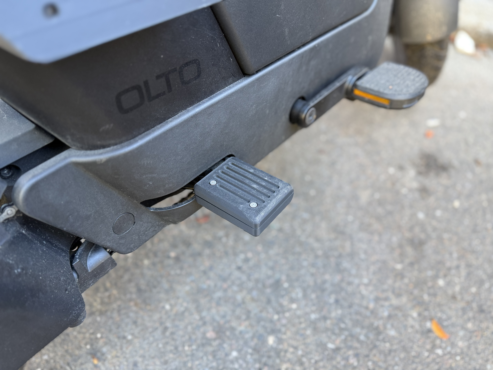
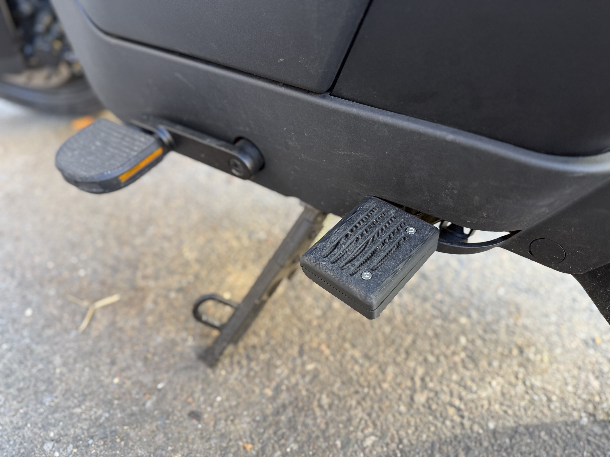

We recently scooped up an olto from Infinite Machine to get around New York easier.  We love it.

Cha loves it because she doesn't have to take the train to work anymore and same goes for me.  The only complaint she had was that the passenger pegs were too dinky to sit comfortably on the back for rides longer than an hour.  

I got lucky and came upon the step files for the stock pegs which unlocked a lot of cool stuff for us.  So behold!  Some 3D printed passenger peg enhancer extenders for the lady.

Excuse the shitty pictures taken with my phone.

