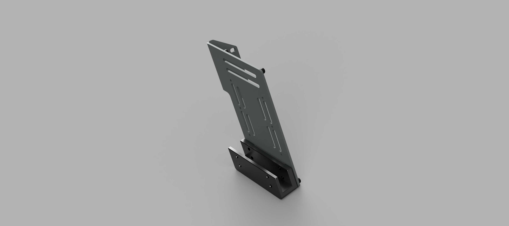
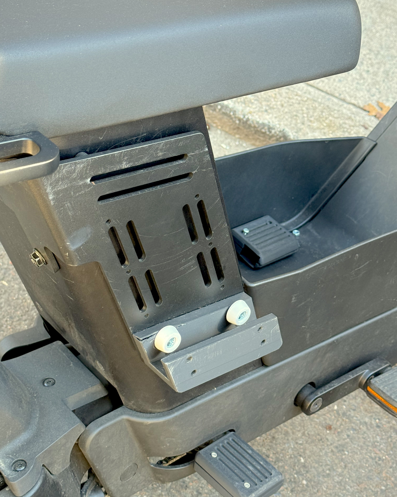
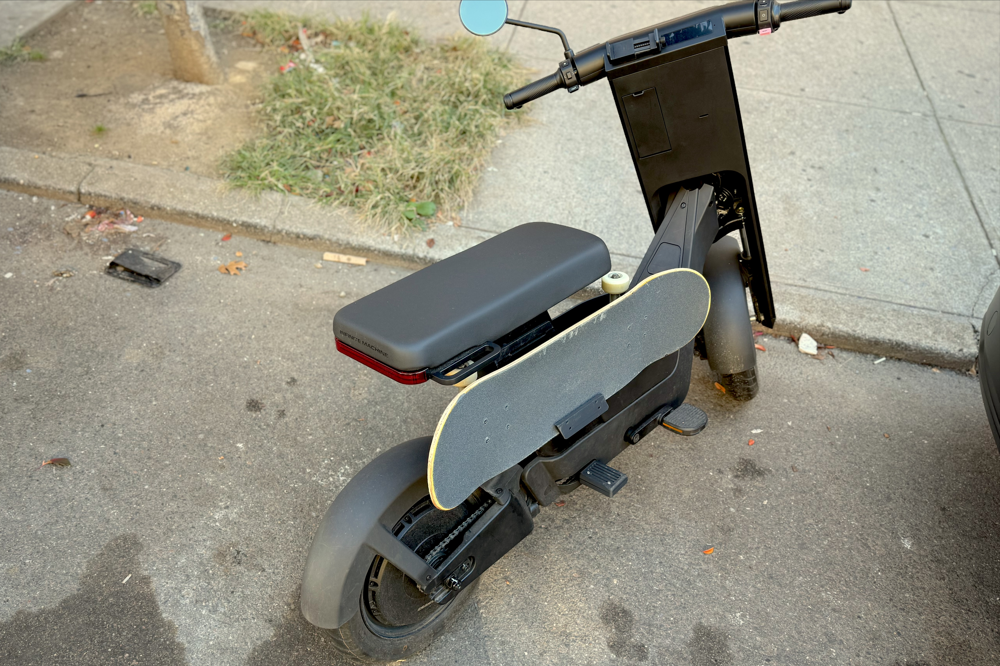

The bracket was made to fit on Infinite Machine's side mounting plate which you can get [here](https://www.infinitemachine.com/products/olto-side-mounting-plate) .

I cranked it a little too much on the first go so it cracked the PLA.  Still works!

Also not in CAD, first run with rubber barnacle guys.  Holds the board in perfectly without needing a top clamp.  Update with correct color coming soon.

